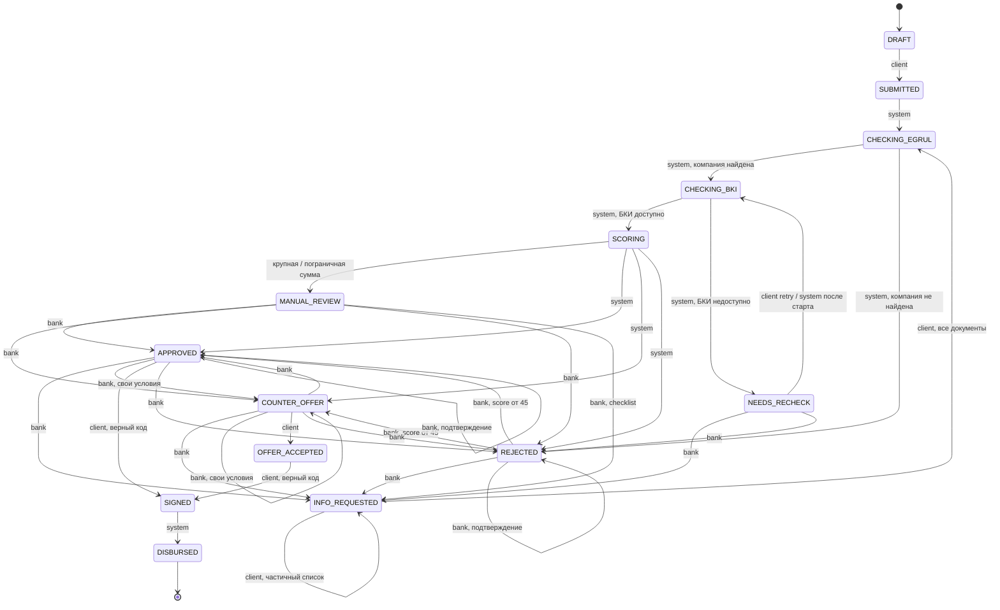

# Состояния заявки

Источник разрешённых переходов — backend/app/domain/state_machine.py.
После демо добавлены MANUAL_REVIEW и INFO_REQUESTED; переходы клиента требуют роли client_owner и доступа
к компании, бухгалтер только просматривает. Решения банка — underwriter либо
совместимый демо-токен; пользователь сотрудника фиксируется в details.reviewer.
Все времена в API — UTC, каждый переход сохраняется с актором и деталями.
Диаграмма согласована с контрактом origin/frontend; исходная версия сохранена в docs/frontend/.

POST создания возвращает SUBMITTED, DRAFT используется внутри транзакции создания
и виден в журнале. Между автоматическими этапами — PIPELINE_STEP_SECONDS (по умолчанию 1).
Автоматическое решение — завершение SCORING, включая отказ; сбой БКИ — failed этап проверки.
История повторной проверки остаётся в events; pipeline показывает последнюю попытку этапа.

COUNTER_OFFER нельзя подписать до принятия. APPROVED подписывается напрямую; accept-offer даёт 409.
SIGNED сохраняется до выдачи; после перезапуска эта выдача дозапускается.
Неверный четырёхзначный код не меняет статус и расходует одну попытку из пяти.
Первые четыре неверные попытки дают 400, пятая и последующие — 429. Неверный формат — 422 без расхода попытки.

Банк рассматривает APPROVED, COUNTER_OFFER, REJECTED, NEEDS_RECHECK и MANUAL_REVIEW.
Во время INFO_REQUESTED он ждёт документы; после полного списка конвейер повторяется.
После OFFER_ACCEPTED, SIGNED или DISBURSED решение менять нельзя.
Во время автоматических проверок сотрудник не вмешивается: возвращается 409.
NEEDS_RECHECK без результата скоринга нельзя одобрить (409/INVALID_TRANSITION, details.reason=BANK_SCORING_REQUIRED).
Формальный переход NEEDS_RECHECK → APPROVED в state_machine требует уже имеющегося
скоринга; в обычном конвейере MVP при NEEDS_RECHECK score отсутствует.

Ручное approve при score от 45 одобряет исходную запрошенную сумму по ставке SPEC,
перекрывая ограничение платёжной способности только с непустым обоснованием.
Counter задаёт собственные сумму/срок, ставка остаётся по SPEC; score <45 запрещён. Исходные score и факторы сохраняются.
Для score ниже 45 ставка не определена: 409/INVALID_TRANSITION,
details.reason=BANK_RATE_UNAVAILABLE, заявка не меняется.
Подтверждение того же решения банком записывается отдельным событием с комментарием.
Отказ не переводится обратно в SUBMITTED: повторная подача создаёт новую заявку.

Невозможный переход возвращает 409/INVALID_TRANSITION с понятным названием статусов.
