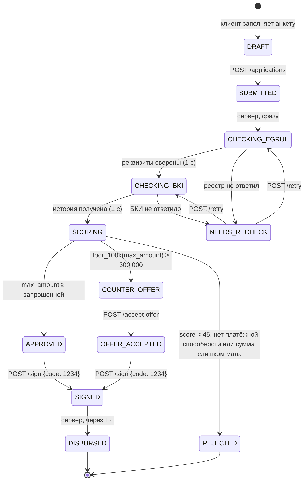

# Состояния заявки

Таблица переходов одна на фронтенд и бэкенд: `frontend/src/api/stateMachine.ts` и `backend/.../domain/state_machine.py`. Недопустимый переход сервер отклоняет с кодом 409 `INVALID_TRANSITION`.

| Статус | Что видит клиент | Кто переводит дальше | Шаг экрана |
|---|---|---|---|
| DRAFT | Черновик (только в интерфейсе) | клиент — «Отправить заявку» | 1–2 |
| SUBMITTED | Заявка отправлена | сервер | 3 |
| CHECKING_EGRUL | Проверка в ЕГРЮЛ | сервер | 3 |
| CHECKING_BKI | Запрос в БКИ | сервер | 3 |
| SCORING | Скоринг | сервер | 3 |
| NEEDS_RECHECK | Нужна повторная проверка | клиент — «Повторить проверку» | 3 |
| APPROVED | Одобрено | клиент — подписание | 4 |
| COUNTER_OFFER | Встречное предложение | клиент — «Принять новые условия» | 4 |
| OFFER_ACCEPTED | Условия приняты | клиент — подписание | 4 |
| REJECTED | Отказ (финальный) | — | 4 |
| SIGNED | Договор подписан | сервер (выдача) | 4 |
| DISBURSED | Кредит выдан (финальный) | — | 4 |

Пока заявка в статусах SUBMITTED, CHECKING_*, SCORING или SIGNED, интерфейс раз в 700 мс запрашивает `GET /applications/{id}`. Таймеров этапов в интерфейсе нет. Подписание: 5 неверных попыток → 429 `TOO_MANY_ATTEMPTS`.
