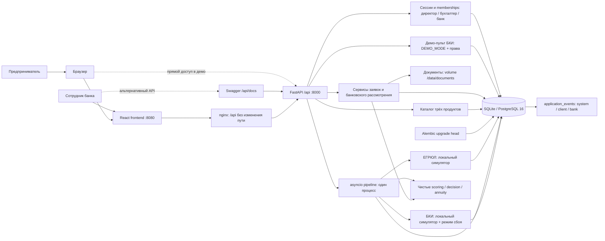

# Архитектура

Фронтенд объединён с origin/frontend; текущие доработки согласованы пользователем. Compose запускает оба сервиса;
localhost:8080 обслуживает интерфейс и /api через nginx, localhost:8000 — прямой API.
deploy/nginx.conf подключает исходный server-конфиг и убирает query string из access-log.
Для независимой проверки проксирования есть тестовый nginx на localhost:18080
через docker-compose.integration.yml; он не заменяет исходники фронтенда.
FastAPI управляет временем жизни БД и задач. На старте выполняются миграции Alembic,
дополняется seed и дозапускаются промежуточные заявки и SIGNED.

Каждая asyncio-задача ждёт паузу вне транзакции. Затем открывает короткую
сессию SQLAlchemy, изменяет статус и пишет событие одной транзакцией.
Общий lock координирует pipeline, клиентские действия, банковское рассмотрение и reset.
Синхронные операции с локальной БД выполняются в процессе API; расчёты малы.
Поддерживается одна реплика Uvicorn. Версия строки обнаруживает конфликт обновления,
но для нескольких процессов потребуются внешняя очередь и координация воркеров.

Domain не импортирует FastAPI, Pydantic и SQLAlchemy. HTTP-модели находятся
в schemas, адаптеры за ABC — в integrations, сохранение и сценарии — в services.
Данные компании фиксируются в snapshot заявки: последующая правка seed не меняет
уже рассчитанное решение. Новая заявка использует данные актуального профиля.

SQLite хранится в именованном Docker volume, код контейнера доступен только
для чтения, UID/GID — 10001. При штатной остановке задачи отменяются; этапы
восстанавливаются из сохранённых статусов, без необходимости хранить задачи в памяти.
Подписание и выдача — переходы состояний, реальные деньги не переводятся.
