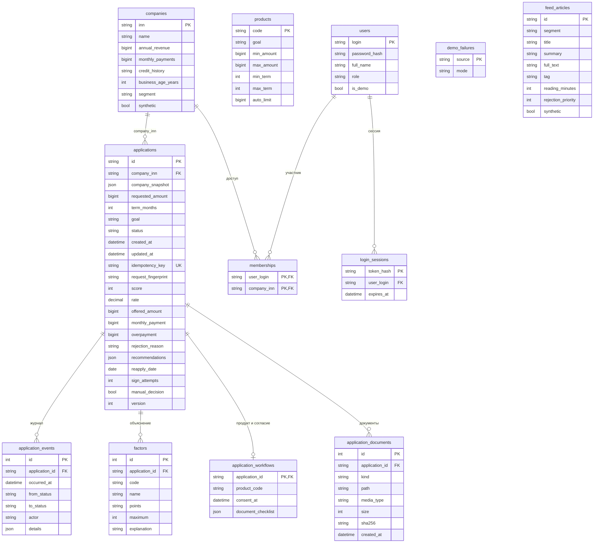

# Модель данных

companies содержит пять синтетических компаний из seed фронтенда (три демо-профиля);
feed_articles — по пять своих материалов на retail/services/production и четыре
на general (тексты — backend/app/db/feed_articles.json, те же, что в моке фронтенда),
плюс три совета после отказа в каждом сегменте. Лента фильтруется по segment, прямой FK
к компании нет. rejection_priority задаёт порядок: советы 0–2 показываются только при
context=rejected и идут первыми, статьи сегмента — 10 и выше. Ответ — не больше 5 статей.

company_snapshot — копия данных профиля, использованных при проверках и расчёте.
Ключ идемпотентности уникален, отпечаток — SHA-256 нормализованного тела запроса.
Баллы факторов хранятся строками Decimal, чтобы SQLite не провёл дробь через float.
Суммы и платежи — целые рубли, ставка — Numeric(5,2). Время записывается в UTC.
SQLite возвращает naive datetime, схема ответа явно добавляет UTC.

Пара application_id/code уникальна в factors. Изменение статуса и событие
сохраняются вместе, actor принимает system/client/bank. Комментарий сотрудника
хранится в details события и доступен клиенту в полной заявке; в HTTP-логи он не пишется.
manual_decision отделяет ручной результат от автоматического, score и факторы
продолжают показывать исходную оценку риска.

Удаление applications каскадно удаляет события и факторы; компании и материалы
не удаляются. demo/reset отменяет активные задачи до очистки таблиц.
Схему SQLite и PostgreSQL обновляет Alembic. Reset каскадно удаляет workflow,
документы и файлы, но сохраняет каталог, пользователей, компании и ленту.
Срок ручной оферты хранится в details.offer банковского события; исходный срок
applications.term_months остаётся параметром заявки.
